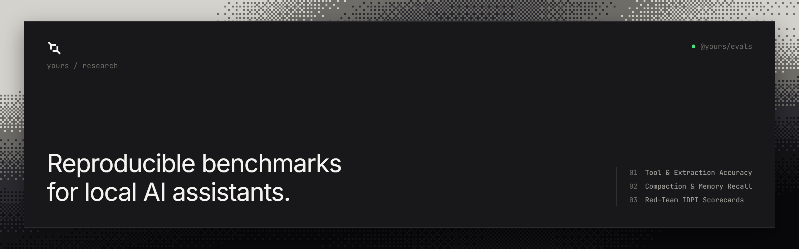
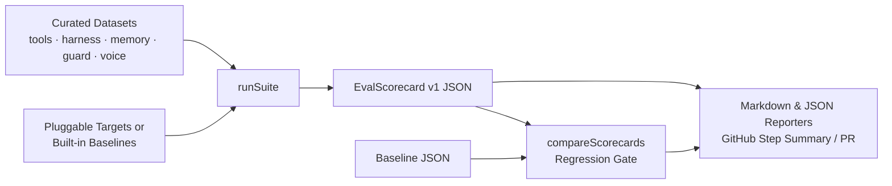

<p align="center">
  <a href="https://yours.sh">
    <picture>
      <source media="(prefers-color-scheme: dark)" srcset="https://raw.githubusercontent.com/yours-research/yours-evals/main/assets/hero-dark.png" />
      <source media="(prefers-color-scheme: light)" srcset="https://raw.githubusercontent.com/yours-research/yours-evals/main/assets/hero-light.png" />
      
    </picture>
  </a>
</p>

<p align="center">
  <a href="https://yours.sh">yours.sh</a> ·
  <a href="https://github.com/yours-research">GitHub Org</a> ·
  <a href="https://huggingface.co/yours-research">Hugging Face</a> ·
  <a href="https://x.com/yoursdotsh">X (@yoursdotsh)</a>
</p>

# `@yours/evals`

**End-to-end, reproducible local-assistant benchmark, regression suite, and scorecard generator for the Yours Research consumer browser AI stack.**

`@yours/evals` ships deterministic built-in baseline evaluators that run zero-network in CI out of the box, while exposing pluggable target interfaces for `@yours/tools`, `@yours/harness`, `@yours/memory`, `@yours/guard`, `@yours/voice`, and live Chromium MV3 / WebGPU extension runners.

---

## Architecture



---

## Suites & Metric Definitions

| Suite | Target Interface / Contract | Key Metrics | What It Verifies |
| --- | --- | --- | --- |
| `tools` | `ToolsEvalTarget` | `aomCompressionRatio`, `schemaValidationF1`, `sandboxSafetyRate`, `sandboxAccuracy`, `multiHopRecall` | Semantic AOM distillation vs raw HTML, Schema v1.1 + legacy alias normalization, isolated sandbox escape blocking & math accuracy, cross-tab multi-hop recall. |
| `harness` | `HarnessEvalTarget` + `RuntimeAdapter` | `compactionFidelity`, `prefixReuseRatio`, `malformedJsonRecoveryRate`, `abortResponsivenessRate`, `meanAbortLatencyMs` | Key-fact retention under token budgets, KV-cache shared-prefix reuse/invalidation, chunked malformed-JSON repair, and `AbortSignal` teardown SLA. |
| `memory` | `MemoryProvider` (`@yours/memory`) | `precisionAtK`, `recallAtK`, `mrr`, `ndcgAtK`, `supersedingAccuracy`, `temporalDecayAccuracy`, `sensitiveDomainLeakRate` | Exact & paraphrased recall, newest-fact superseding, tier-aware temporal decay, and **0%** persistence/leak of banking, auth, token, or SSN records. |
| `guard` | `GuardEvalTarget` (`@yours/guard`) | `attackSuccessRate` (ASR), `falsePositiveRate` (FPR), `trifectaBlockRate`, `detectionF1` | Indirect prompt injection defense across hidden CSS, Unicode smuggling, SVG foreign text, `#HashJack`, fake tool tags, and Lethal Trifecta gating vs benign controls. |
| `voice` | `VoiceEvalTarget` + `VoicePipeline` | `chunkBoundaryAccuracy`, `meanChunkLatencyMs`, `vadOnsetClippingRate`, `bargeInSlaPassRate`, `meanBargeInTeardownMs` | Abbreviation-safe streaming sentence chunking, pre-roll VAD onset capture, and mid-speech barge-in teardown latency SLA. |

---

## CLI Quickstart

```bash
npm install
npm run build

# Run all 5 suites and emit JSON + GitHub-flavored Markdown scorecards
npx yours-evals --suite all --out-json scorecard.json --out-md scorecard.md --fail-on-case-failure

# Run a single suite
npx yours-evals --suite guard --format markdown

# Enforce CI regression gate against a saved baseline scorecard
npx yours-evals --suite all --baseline ./baseline-scorecard.json --max-regression 0.02 --fail-on-case-failure
```

---

## Programmatic Usage (Plugging In Sibling Packages)

```ts
import {
  runSuite,
  compareScorecards,
  formatScorecardMarkdown,
} from '@yours/evals';

// 1. Run with built-in deterministic baselines
const baseline = await runSuite('all');

// 2. Or plug in live @yours/* implementations
const current = await runSuite('memory', {
  targets: {
    memory: () => createMyMemoryProvider(),
  },
});

// 3. Enforce regression threshold in CI
const diff = compareScorecards(baseline, current, 0.02);
if (!diff.passed) {
  console.error(formatScorecardMarkdown(current, diff));
  process.exit(1);
}
```

---

## Yours Research Ecosystem

| Package | Repository | Role |
| --- | --- | --- |
| `@yours/tools` | [`yours-tools`](https://github.com/yours-research/yours-tools) | Canonical Schema v1.1 browser tools, semantic AOM distillation, and isolated sandbox execution. |
| `@yours/harness` | [`yours-harness`](https://github.com/yours-research/yours-harness) | Pluggable local WebGPU / WASM / Chrome AI runtime adapter, prefix slots, compaction, and stream repair. |
| `@yours/memory` | [`yours-memory`](https://github.com/yours-research/yours-memory) | Tiered local hybrid memory with superseding, temporal decay, encrypted export, and sensitive-domain filtering. |
| `@yours/models` | [`yours-models`](https://github.com/yours-research/yours-models) | Signed model manifest verification, chunked HTTP/3 delivery, and WebGPU hardware probing. |
| `@yours/guard` | [`yours-guard`](https://github.com/yours-research/yours-guard) | IDPI DOM/Unicode/#HashJack sanitization, spotlighting, and Lethal Trifecta tool-policy gating. |
| `@yours/voice` | [`yours-voice`](https://github.com/yours-research/yours-voice) | Local VAD with pre-roll, streaming sentence chunking, and low-latency barge-in voice pipeline. |
| `@yours/evals` | [`yours-evals`](https://github.com/yours-research/yours-evals) | Cross-stack benchmark datasets, pluggable suite runners, regression gate, and scorecard reporters. |
| Extension | [`yours-browser-extension`](https://github.com/yours-research/yours-browser-extension) | Chromium MV3 local AI assistant integrating the full `@yours/*` stack. |

---

<p align="center">yours / research · Making local inference for everyone.</p>
